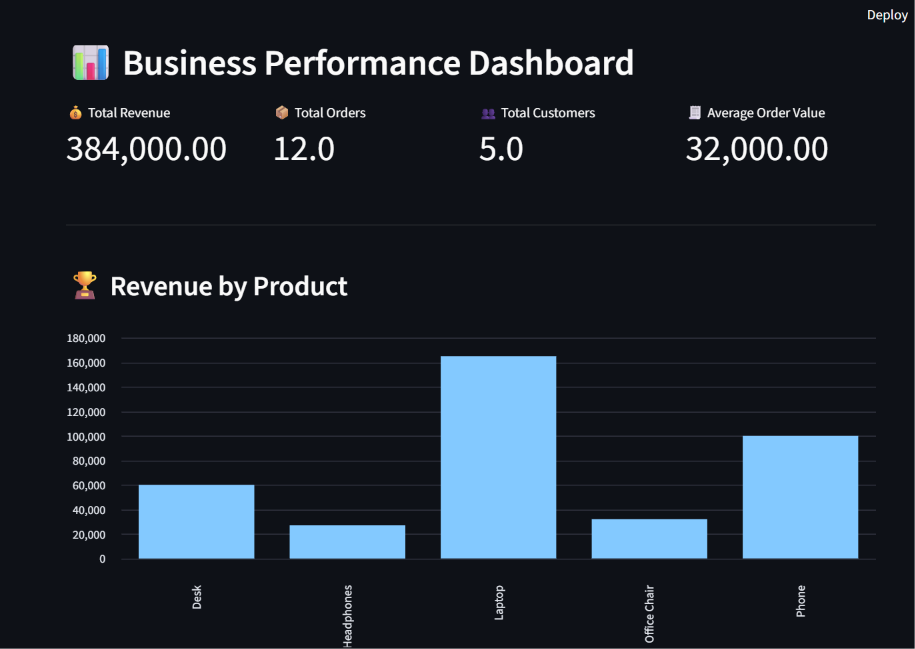
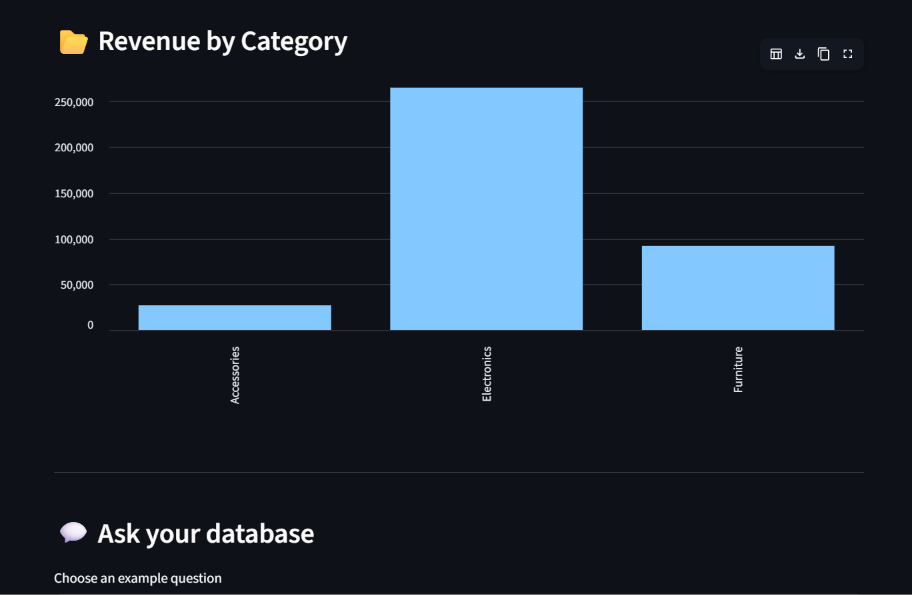
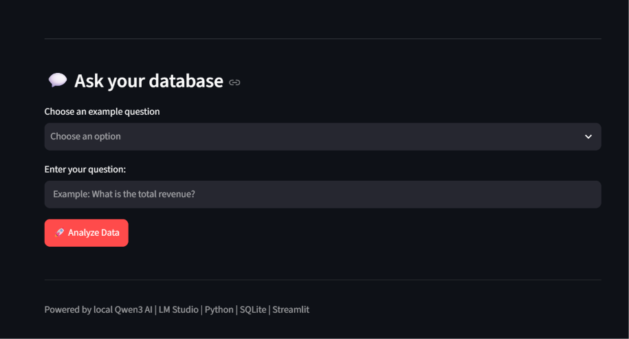

# AI SQL Data Analyst

An AI-powered business intelligence application that allows users to interact with a sales database using natural language. It uses a locally hosted Qwen3 4B model through LM Studio to generate SQL queries, retrieve database results, and provide business insights.

## 1. Project Overview

The AI SQL Data Analyst converts natural language questions into SQL queries and executes them against a local SQLite database.

Users can:

- Ask questions about sales data using natural language.
- Automatically generate SQL queries using local AI.
- Validate SQL queries before execution.
- Retrieve results from a SQLite database.
- View business performance KPIs.
- Filter dashboard data by date.
- Analyze revenue by product and category.
- Receive AI-generated explanations and business insights.

## 2. Technology Stack

| Component | Technology |
|---|---|
| Programming Language | Python |
| Frontend | Streamlit |
| Database | SQLite |
| Data Processing | Pandas |
| AI Model | Qwen3 4B |
| AI Runtime | LM Studio |
| AI Integration | OpenAI-compatible API |
| Configuration | Python dotenv |

## 3. Project Structure

```text
AI-SQL-Data-Analyst/
│
├── app/
│   ├── local_app.py
│   ├── main.py
│   ├── agent.py
│   ├── database.py
│   ├── data_analyst.py
│   ├── sql_generator.py
│   ├── sql_validator.py
│   ├── schema_inspector.py
│   ├── insights.py
│   └── init_db.py
│
├── screenshots/
│   ├── dashboard.png
│   ├── revenue-category.png
│   └── ask-database.png
│
├── tests/
│
├── .gitignore
├── requirements.txt
└── README.md
```

The SQLite database is generated locally and is not included in the GitHub repository.

## 4. Installation

### Step 1: Clone the repository

```bash
git clone https://github.com/debokikanta-creator/AI-SQL-Data-Analyst.git

cd AI-SQL-Data-Analyst
```

### Step 2: Create a virtual environment

```bash
python -m venv .venv
```

Activate it on Windows:

```powershell
.venv\Scripts\activate
```

### Step 3: Install dependencies

```bash
pip install -r requirements.txt
```

### Step 4: Initialize the database

Run the database initialization script:

```bash
python app/init_db.py
```

This creates the local SQLite database, its tables, and sample sales data.

## 5. Local AI Configuration

This project uses LM Studio to run the Qwen3 4B model locally.

Follow these steps:

1. Install and launch LM Studio.
2. Download the Qwen3 4B model.
3. Load the model into LM Studio.
4. Start the local API server.
5. Make sure the server is running at `http://localhost:1234`.

Create a `.env` file in the project root directory:

```env
LOCAL_AI_BASE_URL=http://localhost:1234/v1
LOCAL_AI_MODEL=your-loaded-model-identifier
```

Replace the model identifier with the actual model identifier displayed in LM Studio.

No cloud AI API key is required for the configured local inference workflow.

## 6. Running the Application

Make sure the LM Studio local API server is running and the model is loaded.

From the project root, execute:

```bash
streamlit run app/local_app.py
```

Open the local Streamlit URL displayed in your terminal.

## 7. Example Questions

Users can ask questions such as:

- What is the total revenue?
- Which products generate the highest revenue?
- How many orders are there?
- What are the top 5 products by sales?
- Which category generates the highest revenue?

## 8. SQL Security

The application includes SQL validation before query execution.

Security measures include:

- Only SELECT queries and read-only CTE queries are accepted.
- Multiple SQL statements are rejected.
- Unsafe SQL operations are blocked.
- SQLite read-only database execution is enforced.

These checks help prevent unintended database modifications.

## 9. Business Intelligence Dashboard

The application provides a business performance dashboard with:

- Total Revenue
- Total Orders
- Total Customers
- Average Order Value
- Revenue by Product
- Revenue by Category
- Date-based filtering

## 10. AI-Generated Insights

After executing a natural-language query, the local AI model analyzes the query results and generates a natural-language explanation.

The goal is to make database results easier to understand by highlighting relevant numbers and business patterns.

## 11. Application Screenshots

### Business Performance Dashboard



### Revenue by Category



### Ask Your Database



## 12. Privacy and Deployment

The application uses:

- A locally hosted Qwen3 4B model through LM Studio.
- A local SQLite database.
- A local Streamlit application.

No cloud AI API key is required for the configured local inference workflow.

The `.env` file and local database are excluded from the public GitHub repository.

## 13. Future Enhancements

Potential future improvements include:

- Multi-agent SQL analysis.
- Advanced business forecasting.
- Interactive visualizations.
- Automated report generation.
- More advanced analytical queries.

---

**Developed as an AI-powered Natural Language to SQL Data Analytics project.**